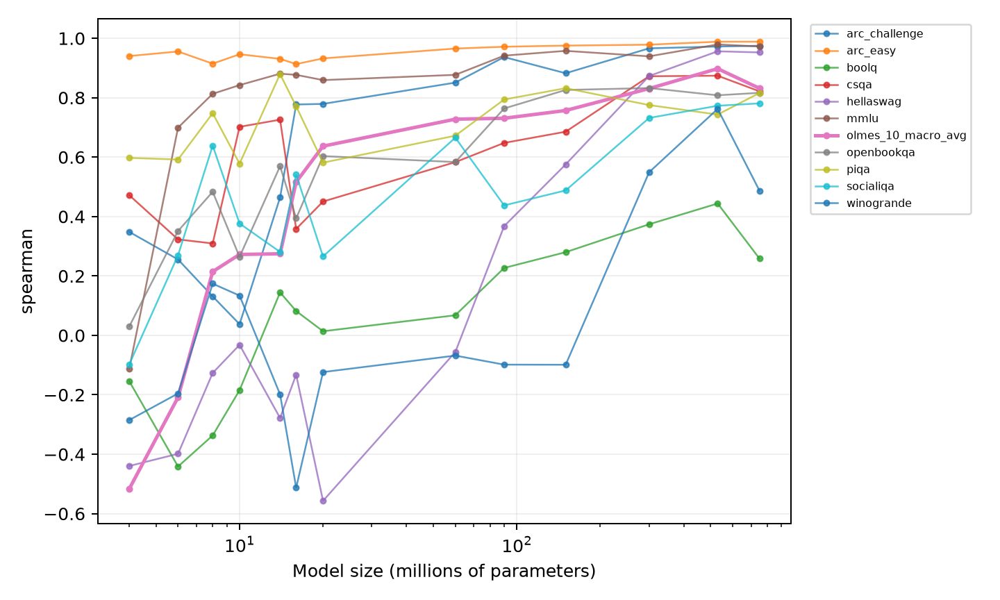
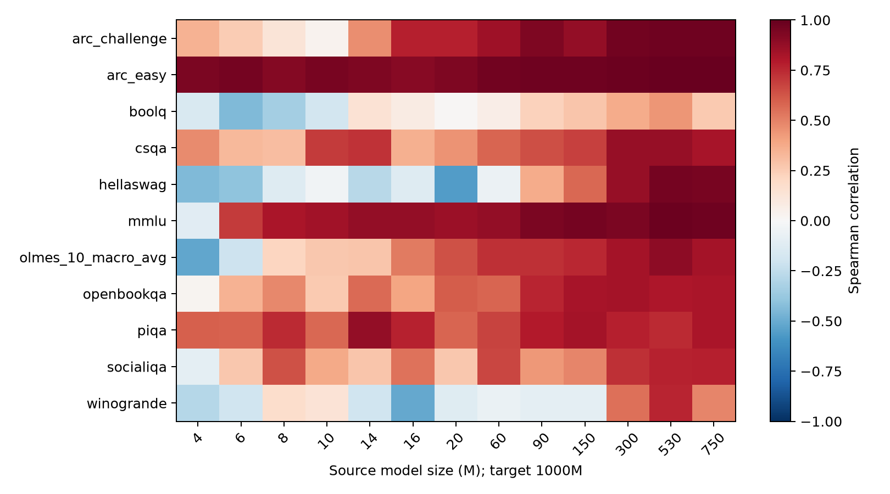
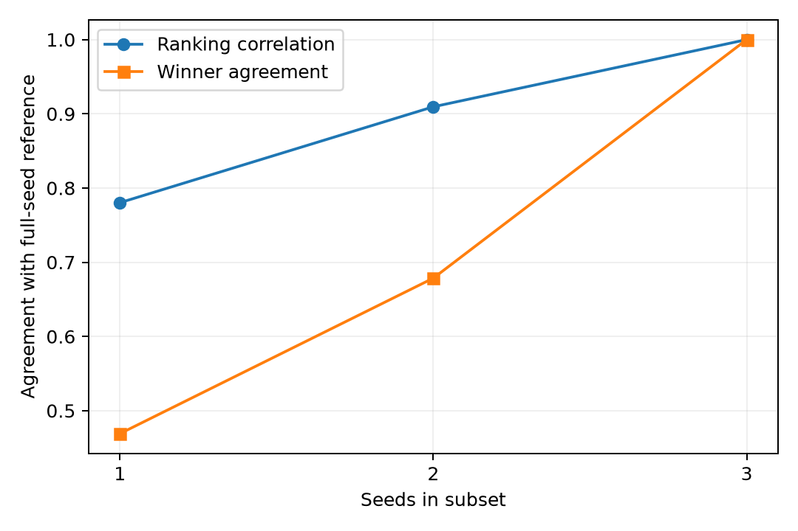
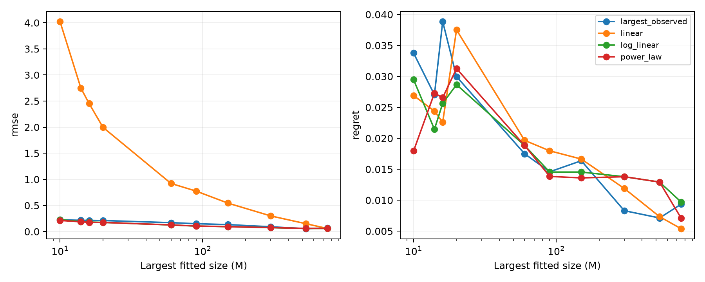

# Beyond Rank Reversals

An Empirical Study of Small-Scale Pretraining Data Selection

Self-Study Project Report | November 2026

Parth Agarwal (2024ADPS0726P)
Divyansh Bisht (2024ADPS0681P)
Keval Kirpekar (2024ADPSxxxxP)

BITS Pilani, Pilani Campus

## Abstract

This self-study examines how reliably smaller language-model experiments can guide pretraining-data selection at a larger model size. It analyses 11,550 released DataDecide observations covering 25 recipes, 14 model sizes, ten task families and their aggregate, with three seeds per cell. No additional models were trained. The study evaluates cross-scale rankings, task differences, seed sensitivity and four prediction methods, followed by robustness checks and an independent reproduction of an earlier rank-reversal census.

Across the ten individual tasks, mean Spearman ranking correlation increases from 0.130 at 4M parameters to 0.830 at 530M, but falls to 0.787 at 750M. Winner selection remains imperfect. Task differences are substantial, seed subsets frequently change the selected recipe, and no prediction method dominates all metrics. All 3,300 historical calibrated pair classifications reproduce exactly. The evidence supports using small-scale experiments as informative but limited measurements, with explicit attention to uncertainty and the cost of choosing a suboptimal recipe.

## Scope of the contribution

The contribution is an offline empirical analysis and reproducibility package built on released observations, together with documented implementation verification. It does not claim new large-scale training, measured GPU savings, a general statistical guarantee or novelty over all previous work.

# 1 Background and research questions

## Why training data selection matters

A data recipe specifies the sources and filtering or mixing rules used to build a pretraining corpus. Training every candidate recipe at a large model size is costly, so smaller models can serve as preliminary experiments. This is useful only if their measurements provide reliable information about the eventual decision.

A model size is its number of parameters. A training token count measures how many token occurrences are processed, including repetitions. A random seed affects stochastic choices such as initialization and data order. Scores after training measure performance on held-out evaluation tasks. This report uses the released primary task scores rather than computing fresh model predictions.

## What ranking and selection measure

Spearman correlation compares relative recipe ranks. Kendall tau-b compares pair orderings while accounting for ties. A good correlation can coexist with an incorrect winner: most recipes may be ordered correctly while the two best recipes are reversed. Top-1 success asks whether the selected recipe has the highest target-scale mean. Top-five hit asks whether any target winner is included among the five source-ranked candidates.

Selection regret is the difference between the best target-scale mean score and the target-scale mean score of the selected recipe. For example, selecting a recipe scoring 0.62 when the best scores 0.65 incurs regret 0.03, or three accuracy percentage points. Normalized regret divides by the target recipe-score range; it is undefined if that range is zero.

## Four empirical questions

1. How well do recipe rankings at each smaller size predict the ranking at 1B parameters?
2. How does predictive reliability differ between evaluation tasks?
3. How sensitive are rankings and winners to the available random-seed repetitions?
4. Do explicit extrapolation methods improve prediction and selection over the largest-observed-scale baseline?

## Connection to decision theory

The practical objective is a good data-selection decision, not merely a low prediction error. Extrapolation introduces model assumptions; limited repetitions introduce measurement uncertainty. A decision procedure should distinguish a useful recommendation from a statistically justified certification, and may need to abstain when the evidence is insufficient.

# 2 Data and experimental design

| Attribute | Verified value |
|---|---|
| Dataset | DataDecide macro-average evaluation table |
| Recipes and sizes | 25 recipes; 14 sizes from 4M to 1B |
| Task entries | 10 individual task families plus their aggregate |
| Replications | Three seeds per recipe, size and task |
| Raw and final rows | 235,125 raw; 11,550 final |
| Missing or duplicate final cells | None |
| Metric | Released primary_metric; higher is better |

The table is pinned to revision 9919b5a0e61e57a85021263918fa82d6ceaee038. Its SHA-256 and the dataset card checksum are included in the package. The analysis removes 10,725 zero-step rows and 212,850 intermediate-checkpoint rows, choosing each run's maximum positive step without inspecting its scores. No missing observations were imputed.

Budgets are consistent across recipes and seeds at a given size. Token budgets change with model size, so the ladder reflects both model size and training budget. Differences cannot be attributed causally to parameter count alone. The aggregate equals the mean of the ten individual task scores to floating-point precision and is not counted as an independent task.

## Selection and held-out evaluation

The main target is 1B. At every smaller size, three-seed recipe means are ranked within each task using all 25 recipes. Target scores are used only for evaluation. Exact source winner ties are broken lexically by recipe name, without target information. Any target-maximizing recipe counts as correct. Sensitivity analyses also average over tied source winners. All target means are noisy reference measurements, not known population truth.

## Uncertainty and dependence

Seed labels differ at 1B; labels do not establish paired experiments. Inference therefore assumes independent runs and does not use cross-scale paired differences. Three seeds provide weak information about variance. Tasks share models, recipe pairs share recipes, and source sizes recur: counts of these comparisons are not independent sample sizes. Statistical significance is not used to disguise these dependencies.

Source evidence: data_quality_audit.json, analysis_observations.csv, training_budgets.csv and the upstream dataset card [1].

# 3 Cross-scale ranking predictability

| Source size | Mean Spearman | Top-1 tasks | Mean regret (pp) |
|---|---|---|---|
| 4M | 0.130 | 2/10 | 4.60 |
| 60M | 0.514 | 3/10 | 1.75 |
| 150M | 0.640 | 3/10 | 1.64 |
| 530M | 0.830 | 4/10 | 0.71 |
| 750M | 0.787 | 5/10 | 0.93 |

The table averages the ten individual tasks, excluding the aggregate. Larger source sizes generally give better ranking information and lower regret, but improvement is not monotonic. Correlation is higher at 530M than at 750M, whereas winner selection succeeds on more tasks at 750M. This illustrates why ranking correlation and exact winner selection must be reported together.

The comparisons are descriptive outcomes for this fixed panel. A result of 5/10 tasks is not a calibrated 50% success probability on new tasks. Small target score gaps and target-seed noise also affect whether a selected recipe is labeled correct. Evidence: cross_scale_predictability.csv and scale_summary.csv.

# 4 Differences between tasks

| Task | Mean Spearman | Top-1 source sizes | Mean regret (pp) |
|---|---|---|---|
| arc_easy | 0.954 | 3/13 | 2.00 |
| boolq | 0.060 | 1/13 | 4.75 |
| olmes_10_macro_avg | 0.459 | 0/13 | 2.03 |
| piqa | 0.721 | 11/13 | 0.09 |
| winogrande | 0.040 | 0/13 | 2.88 |

ARC-Easy is consistently much more predictable than BoolQ and Winogrande under this evaluation. PIQA often identifies the same winner even though its ranking correlation is lower than ARC-Easy's. The aggregate winner is not selected at any of the 13 smaller sizes. This does not imply that every aggregate-based selection is materially poor: regret measures the size of the performance loss.

Task averages give each of the 13 source sizes equal weight. They do not explain the cause of task differences or establish that one benchmark can guide every data-selection objective. Evidence: task_heterogeneity.csv and task_recipe_agreement.csv.

# 5 Random seeds and ranking stability

| Seeds | Mean Spearman | Winner agreement | Resolved pairs |
|---|---|---|---|
| 1 | 0.780 | 46.9% | Undefined |
| 2 | 0.909 | 67.9% | 1.4% |
| 3 | 1.000 | 100.0% | 10.3% |

Every one-, two- and three-seed subset is evaluated at every size. The summary excludes the aggregate. More seeds improve agreement with the full-seed reference in this panel. However, the reference contains the subset itself, so this is not an independent validation; three-seed agreement is perfect by construction.

One-seed variance and uncertainty-based resolution are undefined. For two or three seeds, the resolved fraction uses two-sided Welch comparisons and a threshold of 0.05/14. This correction is per recipe-pair trajectory, not over all tasks and recipe pairs. Pointwise t intervals for individual recipe scores are also saved, with their assumptions and limitations.

Pairs with absolute source-scale Welch statistics below 1 agree with the target ordering about 54.0% of the time, versus 92.9% for statistics at least 4. This descriptive association is consistent with stronger signals being more stable, but cannot establish how much instability is causally due to noise. Evidence: seed_subsampling.csv, seed_uncertainty.csv and signal_to_noise_summary.csv.

# 6 Comparing prediction methods

Four methods receive the same permitted source range: largest observed score, linear a+b*x, log-linear a+b*ln(x), and power-law E+A*x^(-alpha), where x is parameter count in millions. Ten cutoffs, from 10M to 750M, are used. All fits use equal-weight three-seed means; the 1B score never enters fitting.

| Method | Mean RMSE | Mean rank corr. | Top-1 | Regret (pp) |
|---|---|---|---|---|
| largest_observed | 0.154 | 0.575 | 27% | 2.03 |
| linear | 1.397 | 0.546 | 23% | 1.90 |
| log_linear | 0.129 | 0.583 | 26% | 1.90 |
| power_law | 0.127 | 0.533 | 26% | 1.83 |

These averages cover 100 task/cutoff settings. The largest-observed baseline has the highest top-1 rate; power-law has the lowest average RMSE and regret. At the 750M cutoff, linear has the lowest mean RMSE and regret. No method dominates across metrics and cutoffs.

Power-law alpha is constrained to [0.01, 3], with E and A unconstrained. The exponent reaches a bound in 2,344 of 2,750 fits, including the aggregate. Linear produces 1,460 predictions outside [0,1], log-linear 25 and power-law five. None are clipped or discarded; there are no nonfinite or failed fits. These diagnostics limit claims of reliable extrapolation. Evidence: extrapolation_metrics.csv and extrapolation_diagnostics.csv.

# 7 Robustness and historical verification

| Alpha | Reversing | Stable | Within noise |
|---|---|---|---|
| 0.01 | 7 | 932 | 2361 |
| 0.025 | 18 | 1178 | 2104 |
| 0.05 | 32 | 1424 | 1844 |
| 0.1 | 72 | 1718 | 1510 |

The fresh Welch-based census exactly reproduces all 3,300 historical calibrated classifications at alpha=0.05: 32 reversing (0.97%), 1,424 stable (43.15%) and 1,844 within noise (55.88%). These counts include the aggregate task and do not represent independent observations. The earlier artifact remains unchanged; the new result is computed from the pinned seed-level data.

A reversing trajectory has conflicting resolved signs across sizes. Stable means the resolved signs agree, possibly at only one size; within noise means no size is resolved. Neither label establishes equivalence or a permanently stable underlying ranking. Threshold changes materially affect the counts, and unresolved trajectories can contain undetected reversals.

## Sensitivity of the main conclusions

The broad improvement from the smallest to the largest permitted source persists for alternative targets of 530M and 750M, as well as 1B. Removing any one recipe preserves the mean correlation advantage of 530M over 4M. Removing any one individual task leaves mean 4M correlation between 0.040 and 0.193 and mean 530M correlation between 0.812 and 0.873.

Alternative lexical and tied-winner averaging rules change some exact selection outcomes but preserve the broad descriptive picture. Complete-case filtering has no effect because the panel is complete. Alternative power-law exponent bounds change RMSE; at the tested 20M, 150M and 750M cutoffs they retain the same task-averaged winner rates and regrets. This limited sensitivity result does not validate the power-law model generally.

Evidence: rank_reversal_reproduction.json, rank_reversal_sensitivity.csv, robustness_targets_ties.csv, robustness_recipe_exclusion.csv, robustness_power_bounds.csv and robustness_findings.json.

# 8 Implementation and lessons from the study

## The selection algorithm

The existing Extrapolation Track and Stop implementation collects observations at smaller scales, fits performance curves, compares a predicted winner with alternatives, and allocates further observations or stops according to its decision rules. The present empirical comparison does not benchmark its complete adaptive policy; it evaluates fixed offline selection and extrapolation strategies.

## Earlier numerical verification

Prior project work identified sensitivity to parameter units in uncertainty calculations and unsupported certification under bounded fits. Corrections equilibrate the relevant Jacobian columns before assessing numerical rank and distinguish recommendations from justified certification. The earlier documented 100-seed synthetic counterexample produced 61 incorrect certifications before correction. That evidence is a constructed numerical test, separate from real DataDecide observations and from this new empirical pipeline [3].

The earlier 479-test record is historical and is not presented as the test count of this run. This study adds six focused checks covering rank/regret calculations, target-independent tie handling, Welch calculations against SciPy, undefined one-seed inference, known-curve predictions and the prediction/evaluation interface. These complement rather than prove end-to-end scientific validity.

## What the self-study illustrates

Rank prediction, score prediction and recipe selection are distinct objectives. A model can rank most recipes correctly while selecting the wrong winner. A method can predict absolute scores poorly while preserving useful orderings. Conversely, a flexible extrapolator can reduce numeric error while relying heavily on parameter constraints.

The study also illustrates why experimental units matter. Three seeds are not enough to treat uncertainty as known; resampling cannot create new independent runs. Repeated pairwise comparisons share recipes, and aggregate metrics overlap their component tasks. Numerical conditioning, statistical assumptions and reproducible data processing all influence the reliability of a final decision.

# 9 Conclusion and reproducibility

Small-scale pretraining experiments contain useful information about larger-scale data-recipe performance, but their reliability is task-dependent and imperfect. In this panel, larger source sizes generally improve ranking agreement and reduce regret; exact winner selection remains difficult. Seed sensitivity and extrapolation diagnostics show why a single score or fitted curve is insufficient evidence for a confident decision.

The strongest outcome is a verified empirical account of where small-scale information is useful and where it is uncertain. The study does not establish universal transferability, a new compute-saving result or a general guarantee for Extrapolation Track and Stop. Future work could add independent repetitions, additional datasets and a prospectively fixed adaptive-policy evaluation.

## Reproduction

The analysis was rerun offline into a clean directory. All 25 numerical CSV artifacts matched the original run at relative tolerance 1e-10 and absolute tolerance 1e-12, with identical rows and columns. All six targeted tests passed. Verification details are in reproducibility_verification.json.

Install the versions in requirements-study.txt, then run: python tools/study_reproduce.py --output results/reproduced-run. The output directory must not already exist. The package includes the exact input table, its source card, hashes, scripts, executed result-inspection notebooks, figures and machine-readable outputs. The full reproduction command performs the computations rather than merely displaying notebook output.

## Contributions and assistance

This report is prepared for joint submission by Parth Agarwal, Divyansh Bisht and Keval Kirpekar. The repository and analysis are presented as shared project work; individual implementation roles have not been independently established. AI tools were used substantially for code implementation, debugging, review, analysis orchestration and report preparation. Numerical findings in this report are derived from the executed scripts and saved observations, rather than invented values.

## References

[1] Magnusson, I., et al. DataDecide: How to Predict Best Pretraining Data with Small Experiments (2025). Dataset and dataset card: https://huggingface.co/datasets/allenai/DataDecide-eval-results. Pinned revision and checksum appear in data_quality_audit.json.

[2] Shared project repository: https://github.com/ParthAgarwalGit/pretraining-data-decision-theory. Code baseline for this study: 61d5728eca5167516f62daf67032ece8f3893af7. Analysis-stage commits are recorded in stage provenance and Git history.

[3] Course submission corrections and verification, PR 35: https://github.com/ParthAgarwalGit/pretraining-data-decision-theory/pull/35. Historical results and their original provenance are inventoried in artifact_inventory.json; fresh empirical results are under results/empirical_study.
